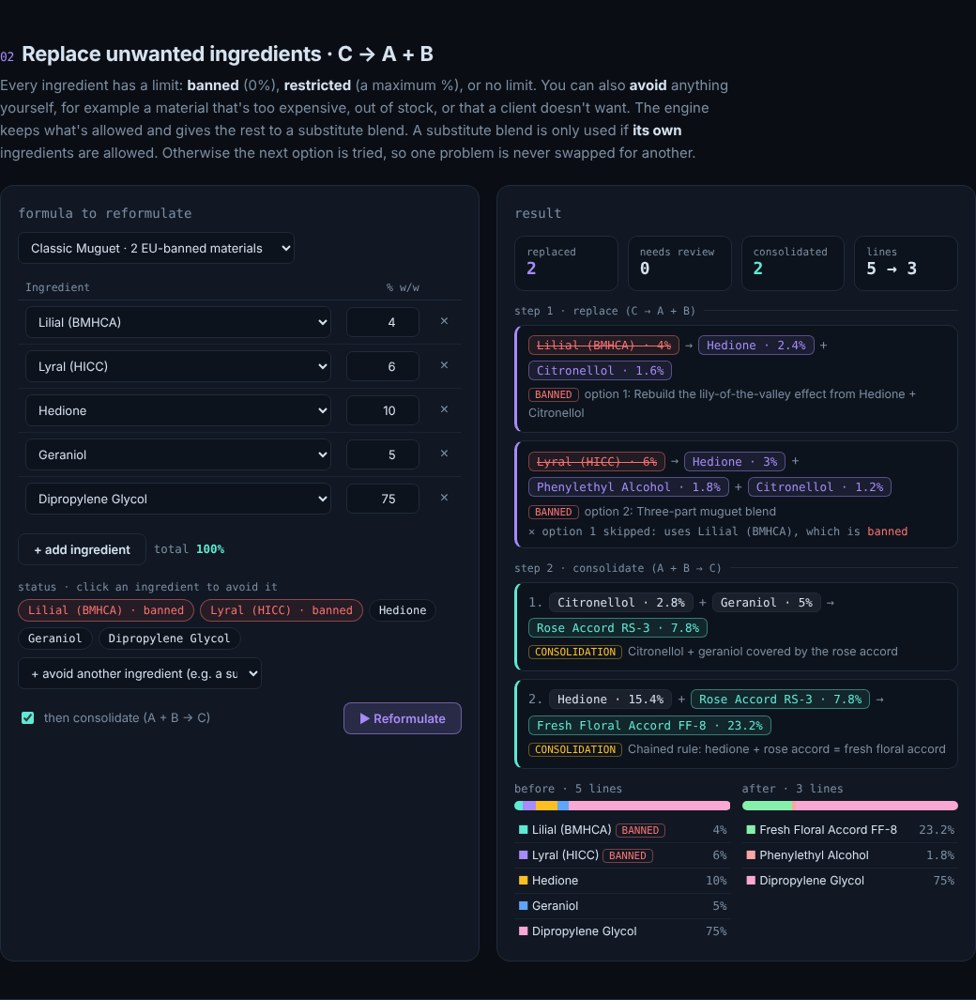

# Formula Substitution Engine (A + B → C · C → A + B)

**Live demo:** https://chandana-galgali.github.io/formula-substitution-engine/
**Stack:** Java 17 · Spring Boot 3 · Apache Maven · SQL (H2) · JUnit 5




## What it does

Perfume formulas change constantly. Materials get banned or restricted, go out of stock, get too expensive, or a client doesn't want them. This engine handles the two substitution jobs that come up most. Both are built on **O(1) HashMap look-ups**.

| | Consolidate · **A + B → C** | Replace · **C → A + B (+ …)** |
|---|---|---|
| When | Two raw materials are already covered by one pre-blended accord | An ingredient is banned, over its limit, or simply not wanted |
| Example | Linalool + Linalyl Acetate → Lavender Accord | Lilial (banned in EU) → 60% Hedione + 40% Citronellol |
| HashMap | `PairKey(A, B) → rule` | `ingredient → max %` and `ingredient → replacement options` |

### 1. Consolidate (A + B → C)

1. Rules live in a **SQL** table and are loaded once into a **`HashMap<PairKey, SubstitutionRule>`**. `PairKey` sorts the two codes, so A + B and B + A hit the same key.
2. The engine checks ingredient pairs, swaps the first match for the accord (C gets A% + B%), and repeats so that **chained rules** work, e.g. *Lavender Accord + Coumarin → Fougère Base*.
3. Each step removes two lines and adds one, so the loop always ends.

### 2. Replace (C → A + B)

1. Every ingredient has a limit: **banned** (0%), **restricted** (a max %), or none. The user can also **avoid** any ingredient (cost, supply, client request).
2. For each line over its limit, the engine **keeps what's allowed** and hands the excess to a replacement recipe. For example, oakmoss at 0.5% with a 0.1% limit keeps 0.1% and replaces 0.4% with Evernyl + Cedarwood.
3. Each ingredient can have several recipes (option 1, 2, …). A recipe is **skipped if any of its own parts is banned, restricted or avoided**, so one problem is never swapped for another. Example: Lyral's option 1 is Lilial, but Lilial is banned too, so option 2 is used.
4. If no option works, the ingredient is **left in place and flagged for a perfumer's review**. Nothing is guessed and nothing is lost.

**Reformulation pipeline:** replace first, then consolidate. The consolidation step gets a filter so it never folds a banned, restricted or avoided ingredient back into an accord.

### Proof for the O(1) claim

A **linear-scan** version (the "manual check", O(R) per pair) is kept on purpose so the speed-up can be measured:

| Rules in the book | HashMap comparisons / lookup | Linear-scan comparisons / lookup | Measured speed-up (JVM, 2,000 lookups) |
|---|---|---|---|
| 1,000  | 1 | ~750    | ~30×  |
| 10,000 | 1 | ~7,500  | ~200× |
| 50,000 | 1 | ~37,500 | ~880× |

*(Indicative micro-benchmark with a warm-up pass. Run `GET /api/benchmark` to measure on your own machine.)*

## Design (OOP)

```
src/main/java/com/chandana/formulaengine
├── model/        Records: Ingredient, SubstitutionRule, ReplacementRecipe, FormulaLine, results
├── engine/       Pure Java, no Spring. Easy to unit-test
│   ├── PairKey               order-independent key: A+B == B+A
│   ├── RuleLookup            interface (strategy pattern)
│   ├── HashMapRuleLookup     O(1)
│   ├── LinearScanRuleLookup  O(R) baseline
│   ├── SubstitutionEngine    A + B -> C
│   ├── ReplacementEngine     C -> A + B
│   └── Benchmark
├── repository/   JdbcTemplate + SQL (schema.sql, data.sql), incl. a JOIN for recipes + parts
├── service/      loads tables into HashMaps, validates input, runs the pipeline
└── web/          REST controller
```

- **Encapsulation:** the HashMap indexes are private and read-only. Rules can only be added through the service, which validates them.
- **Abstraction / polymorphism:** the engine only knows the `RuleLookup` interface, so the lookup strategy can be swapped without changing engine code.
- **Validation at load time:** recipe fractions must add up to 1, and a recipe can't use its own target.
- **Tests:** 19 engine unit tests + 5 Spring Boot API tests (`mvn test`).

### Database

| Table | Holds |
|---|---|
| `ingredient` | id, name, category, `status` (ACTIVE / RESTRICTED / BANNED), `max_percent`, regulatory note |
| `substitution_rule` | A + B → C rules |
| `replacement_recipe` | one replacement option per row: target + priority |
| `replacement_part` | the substitutes in each recipe and their share (`fraction`) |

## Run it locally

Requirements: **JDK 17 or newer** and **Maven** (or IntelliJ IDEA, which includes Maven).

```bash
mvn test              # runs the unit tests and API tests
mvn spring-boot:run   # starts the app
```

Then open:

- http://localhost:8080 for the same demo page, now talking to the **real Java API** (the badge turns green)
- http://localhost:8080/h2-console for the SQL tables (JDBC URL `jdbc:h2:mem:formuladb`, user `sa`, no password)

## REST API

| Method | Endpoint | Description |
|---|---|---|
| GET  | `/api/health` | status + number of rules loaded |
| GET  | `/api/ingredients` | all ingredients incl. status and limits |
| GET  | `/api/rules` | A + B → C rules |
| POST | `/api/rules` | add a rule `{ingredientA, ingredientB, result, reason, note}` |
| GET  | `/api/recipes` | C → A + B replacement recipes |
| POST | `/api/formulas/optimize` | consolidate only: `{strategy, lines: [{ingredientId, percentage}]}` |
| POST | `/api/formulas/reformulate` | replace, then consolidate: `{lines, avoid: ["GAL"], consolidate: true}` |
| GET  | `/api/benchmark?rules=10000&lookups=2000` | HashMap vs linear scan |

Example:

```bash
curl -X POST http://localhost:8080/api/formulas/reformulate -H "Content-Type: application/json" \
  -d '{"consolidate":true,"avoid":[],"lines":[{"ingredientId":"LIL","percentage":4},{"ingredientId":"LYR","percentage":6},{"ingredientId":"HED","percentage":10},{"ingredientId":"GER","percentage":5},{"ingredientId":"DPG","percentage":75}]}'
```

## About the live demo

GitHub Pages can only host static files, so `docs/index.html` contains a line-by-line JavaScript port of both Java engines. Spring Boot serves the **same file** (Maven copies `docs/` into `static/`). When the page detects the Java API, it uses the API instead.

## Background & data note

This is a public rebuild of the approach I used during my **Java Developer Internship at Keva (Jan–Mar 2024)**. The ingredient names are common, publicly known aroma materials, and the bans shown are real EU cosmetics rules: Lilial from 1 Mar 2022 (Reg. EU 2021/1902), and Lyral (HICC) plus the oakmoss allergens atranol and chloroatranol from 23 Aug 2021 (Reg. EU 2017/1410). All accords, recipes, limits and percentages are **made up for illustration** and are not company formulas.
