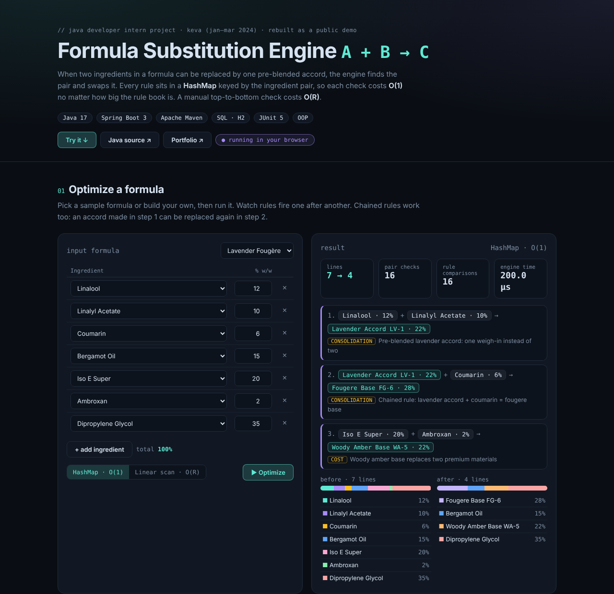

# Formula Substitution Engine (A + B → C)

**Live demo:** https://chandana-galgali.github.io/formula-substitution-engine/
**Stack:** Java 17 · Spring Boot 3 · Apache Maven · SQL (H2) · JUnit 5



## What it does

In fragrance manufacturing, a formula often contains two raw materials that can be replaced by one pre-blended accord. For example, *Linalool + Linalyl Acetate → Lavender Accord*. Checking every formula against a long list of rules by hand is slow and easy to get wrong.

This engine:

1. Stores the replacement rules (**A + B → C**) in a **SQL** table.
2. Loads them once into a **`HashMap<PairKey, SubstitutionRule>`**, so checking any ingredient pair costs **O(1)**.
3. Scans a formula, replaces every matching pair, and repeats so that **chained rules** work. For example, *Lavender Accord + Coumarin → Fougère Base*.
4. Keeps the total percentage the same, merges duplicates, and logs every step with the reason for it.

A **linear-scan** version (the "manual check", O(R) per pair) is kept on purpose so the speed-up can be measured:

| Rules in the book | HashMap comparisons / lookup | Linear-scan comparisons / lookup | Measured speed-up (JVM, 2,000 lookups) |
|---|---|---|---|
| 1,000  | 1 | ~750    | ~30×  |
| 10,000 | 1 | ~7,500  | ~200× |
| 50,000 | 1 | ~37,500 | ~880× |

*(Indicative micro-benchmark with a warm-up pass. Run `GET /api/benchmark` to measure on your own machine.)*

## Design (OOP)

```
src/main/java/com/chandana/formulaengine
├── model/        Records: Ingredient, SubstitutionRule, FormulaLine, SubstitutionResult
├── engine/       Pure Java, no Spring. Easy to unit-test
│   ├── PairKey               order-independent key: A+B == B+A
│   ├── RuleLookup            interface (strategy pattern)
│   ├── HashMapRuleLookup     O(1)
│   ├── LinearScanRuleLookup  O(R) baseline
│   ├── SubstitutionEngine    the A + B -> C algorithm
│   └── Benchmark
├── repository/   JdbcTemplate + SQL (schema.sql, data.sql)
├── service/      loads rules into the HashMap, validates input
└── web/          REST controller
```

- **Encapsulation:** the HashMap index is private and read-only. Rules can only be added through the service, which validates them.
- **Abstraction / polymorphism:** the engine only knows the `RuleLookup` interface, so the lookup strategy can be swapped without changing engine code.
- **Termination:** every substitution removes two lines and adds one, so the loop always ends.

## Run it locally

Requirements: **JDK 17 or newer** and **Maven** (or IntelliJ IDEA, which includes Maven).

```bash
mvn test              # runs the unit tests and API tests
mvn spring-boot:run   # starts the app
```

Then open:

- http://localhost:8080 for the same demo page, now talking to the **real Java API** (the badge turns green)
- http://localhost:8080/h2-console for the SQL tables (JDBC URL `jdbc:h2:mem:formuladb`, user `sa`, no password)

## REST API

| Method | Endpoint | Description |
|---|---|---|
| GET  | `/api/health` | status + number of rules loaded |
| GET  | `/api/ingredients` | all ingredients and accords |
| GET  | `/api/rules` | the rule book |
| POST | `/api/rules` | add a rule `{ingredientA, ingredientB, result, reason, note}` |
| POST | `/api/formulas/optimize` | `{strategy: "HASHMAP" or "LINEAR_SCAN", lines: [{ingredientId, percentage}]}` |
| GET  | `/api/benchmark?rules=10000&lookups=2000` | HashMap vs linear scan |

Example:

```bash
curl -X POST http://localhost:8080/api/formulas/optimize -H "Content-Type: application/json" \
  -d '{"strategy":"HASHMAP","lines":[{"ingredientId":"LIN","percentage":12},{"ingredientId":"LNA","percentage":10},{"ingredientId":"DPG","percentage":78}]}'
```

## About the live demo

GitHub Pages can only host static files, so `docs/index.html` contains a line-by-line JavaScript port of the Java engine. Spring Boot serves the **same file** (Maven copies `docs/` into `static/`). When the page detects the Java API, it uses the API instead.

## Background & data note

This is a public rebuild of the approach I used during my **Java Developer Internship at Keva (Jan–Mar 2024)**. The ingredient names are common, publicly known aroma materials. All accords, rules and percentages here are **made up for illustration** and are not company formulas.
